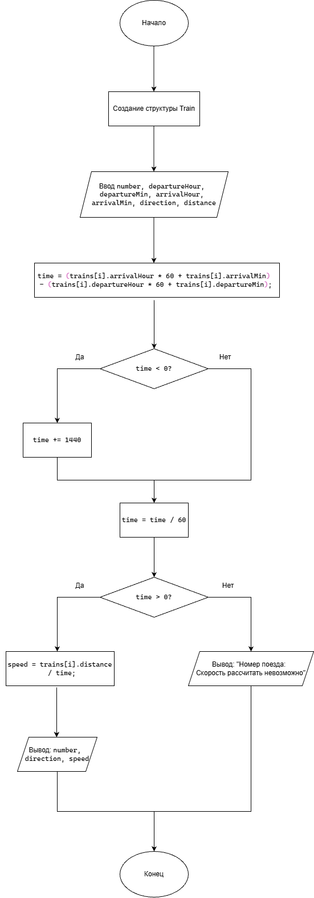

# Домашнее задание к работе 18

## Условие задачи

Создать структуру для хранения указанной в индивидуальном варианте записи, организовать в программе ввод 5-10 различных записей, из полученного массива структур найти и напечатать информацию: 
Запись «Поезд»:
No поезда
Время прибытия
Время отбытия
Направление
Расстояние

Вывести среднюю скорость каждого поезда.

## 1. Алгоритм
### Алгоритм
```
1. Начало.
2. Создать структуру «Поезд».
3. Ввести данные о 5 поездах.
4. Рассчитать время в пути каждого поезда.
5. Вычислить среднюю скорость.
6. Вывести результаты на экран.
7. Конец
```
### Блок-схема


## 2. Реализация программы
```
#define _CRT_SECURE_NO_WARNINGS
#include <stdio.h>
#include <locale.h>

struct Train {
    int number;
    int departureHour;
    int departureMin;
    int arrivalHour;
    int arrivalMin;
    char direction[30];
    float distance;
};

int main() 
{
    setlocale(LC_ALL, "RUS");
    struct Train trains[5];
    int i;
    float time, speed;
    for (i = 0; i < 5; i++) 
    {
        printf("\nПоезд %d\n", i + 1);
        printf("Номер поезда: ");
        scanf("%d", &trains[i].number);
        printf("Время отправления (часы минуты): ");
        scanf("%d%d", &trains[i].departureHour, &trains[i].departureMin);
        printf("Время прибытия (часы минуты): ");
        scanf("%d%d", &trains[i].arrivalHour, &trains[i].arrivalMin);
        printf("Направление: ");
        scanf("%29s", trains[i].direction);
        printf("Расстояние (км): ");
        scanf("%f", &trains[i].distance);
    }
    printf("\nСредняя скорость поездов:\n");
    for (i = 0; i < 5; i++) 
    {
        time = (trains[i].arrivalHour * 60 + trains[i].arrivalMin) - (trains[i].departureHour * 60 + trains[i].departureMin);
        if (time < 0)
            time += 1440;
        time = time / 60;
        if (time > 0) 
        {
            speed = trains[i].distance / time;
            printf("\nНомер поезда: %d\n", trains[i].number);
            printf("Направление: %s\n", trains[i].direction);
            printf("Средняя скорость: %.2f км/ч\n", speed);
        }
        else 
        {
            printf("\nНомер поезда: %d. Скорость рассчитать невозможно.\n",
                trains[i].number);
        }
    }
}
```
### 3. Результаты работы программы
```
Поезд 1
Номер поезда: 125
Время отправления: 8 30
Время прибытия: 11 30
Направление: Moscow
Расстояние: 240

Поезд 2
Номер поезда: 210
Время отправления: 9 00
Время прибытия: 13 00
Направление: Kazan
Расстояние: 320

Средняя скорость поездов:

Номер поезда: 125
Направление: Moscow
Средняя скорость: 80,00 км/ч

Номер поезда: 210
Направление: Kazan
Средняя скорость: 80,00 км/ч
```
### 4. Информация о разработчике

Дегтярева Полина, бИЦТ-262
